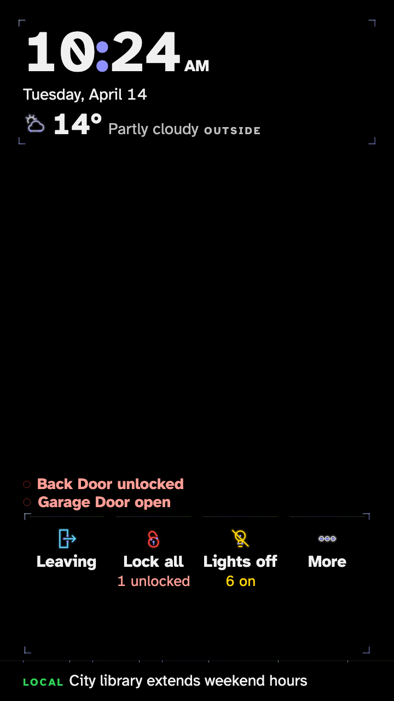
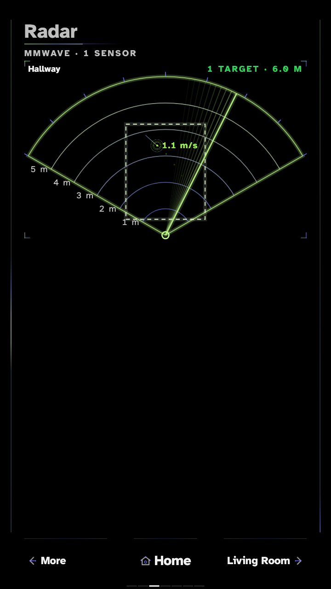
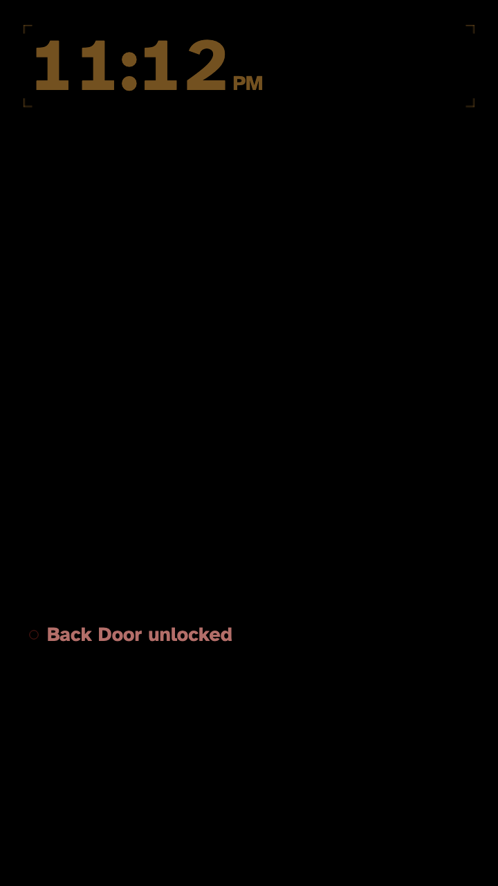
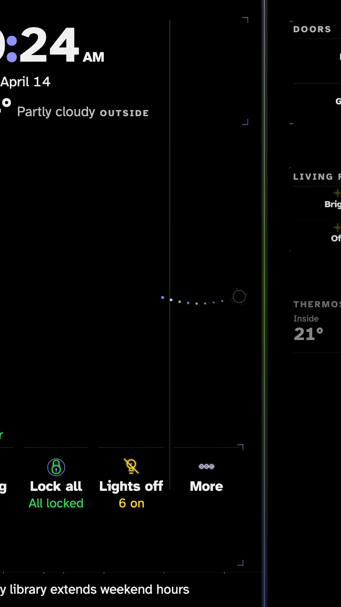
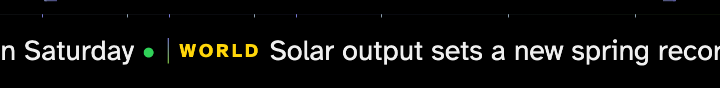

# Mashrabiya

**Mashrabiya** (Arabic مشربية, pronounced *mash-ra-BEE-ya*) is the carved wooden lattice screen of
traditional Arabic architecture: it lets light and air through while keeping the home behind it
private. This card borrows the idea for glass.

Mashrabiya is a [Home Assistant](https://www.home-assistant.io/) dashboard card, plus a Raspberry Pi
kiosk recipe, for a **two-way-mirror smart display**: a portrait monitor mounted behind a sheet of
two-way glass, so the wall is a plain mirror until something on it needs your attention.

It is one Lovelace JavaScript module (`mashrabiya-card`) and a small logic file. It fills a panel-view
dashboard, is sized in physical millimetres so text is legible at arm's length and at a glance from the
doorway, and draws everything in light on black, because on a two-way mirror black *is* the mirror and
anything filled glows through the glass as a rectangle.

> Status: 0.1.1, early release. The card is tested and generic, and runs on one real mirror; see
> [RELEASE-CHECKLIST.md](RELEASE-CHECKLIST.md) for what is still unverified (clean installs, minimum
> Home Assistant version).

## Features

- **Main glance page.** Clock, date, weather with a small animated glyph, a rain warning when the
  hourly forecast expects precipitation, one status line that says in words whether you need to act
  ("Front Door unlocked", "Garage open", "Internet down", or "All clear"), and a row of big buttons
  (Leaving, Lock all, Lights off, More). The middle of the glass is left empty and still: that is
  where your face is reflected.
- **More page.** Per-lock buttons with a live padlock and door state, scenes, a thermostat with
  target and mode, what is playing on your media players, and a house summary ("Someone home" or
  "Away", indoor air, internet).
- **Radar page.** A live scope for each mmWave presence radar it finds (LD2450-style target x/y
  sensors): range rings, the configured detection zone, each target with a fading trail and its speed.
- **A page per room.** Built from your Home Assistant areas: arc gauges for temperature (or the
  thermostat) and humidity, an air-quality meter, occupancy, doors and windows, the room's locks as
  padlocks, fragrance diffusers, lights with their real colour and brightness, fans, blinds, and what
  is playing. Read-only; Previous, Home and Next along the bottom edge, and a neutral page indicator
  centred under Home.
- **Privacy for guests.** `privacy: auto` (the default) hides the Radar page, room occupancy and the
  presence word while your configured person is away; `always` and `off` are there too.
- **Stale data.** If the connection to Home Assistant drops for 10 s, the status line says
  "Connection lost", never "All clear", and every reading dims until it is back.
- **Fragrance diffusers.** Discovered on their own (Pura-style entities): two vials per diffuser with
  the liquid level in the scent's colour, the active vial lit with wisps rising, intensity as a
  five-step meter, a timer ring, Low and Offline marks, and "… scent low" on Main. Read-only.
- **Open-door alert.** While a configured door is open its alert's marks breathe red: the ring of the
  "... open" status line on Main, the door's icon on its room page and its glyph on More. The words stay
  steady in a lighter, legible red. It runs even at night (dimmer, still red); steady under reduced
  motion. There is no screen border.
- **One colour per severity.** Fine is green, take a look is orange, act now is red, the same on the
  status line, the padlocks, More and the room pages. At night those warnings keep their colours,
  dimmed but legible, and everything else turns amber.
- **Padlocks.** Each lock is an animated padlock that follows its real state: sealed when locked, the
  shackle swung open when unlocked, red when jammed, a turning ring while it moves, a slash when
  offline, with its door drawn beside it when open. Lock all sums them up. It still never unlocks.
- **News ticker.** Headlines from RSS feeds you configure along the bottom edge, one at a time with a
  short fade (`ticker: scroll` scrolls them instead). Main is otherwise still but for the weather glyph.
- **Vivid, animated chrome.** Three hues per page on brackets, underlines and rails, kept 40 degrees
  away from every colour that means something, light rails down the edges of detail pages with a
  travelling highlight, a coloured wipe and parallax on page moves, icons that pop and draw themselves
  in, readings that roll and flash when they change. On entry, by tap or by swipe, gauges, bars and
  vials settle in a hair short of their value, readings roll up into place and labels track in, always
  within a few percent of the truth (nothing counts up from zero). All transform and opacity, held to an
  entrance of about 950 ms.
- **Pages fit the glass.** Detail pages have a fixed header and navigation row; rows, diffusers and
  radar scopes go two to a row where that is safe, and a page that still does not fit scrolls its body
  by a vertical drag, with a "More ▾" cue.
- **Text size.** `text_scale` (0.8 to 2) enlarges all text and the icons beside it; at the default no
  text is smaller than 9 mm. `prefers-contrast: more` turns secondary text full white.
- **Touch effects.** A reticle where a finger lands, a short fading trail while dragging, a chevron
  burst on a swipe. Pages are a loop you swipe through like a carousel: swipe left for the next page
  (it comes in from the right), right for the previous one. The page follows your finger and lets go
  at a quarter of the way across, or springs back; swipes never press buttons. `transition: fade`
  swaps the slide for a crossfade, which a drag also drives.
- **Mirror mode.** Double-tap bare glass (not a button) and the screen fades to pure black over 400 ms,
  leaving only the mirror. It fades back after `mirror_timeout` (default 3 minutes), on another double tap,
  or at once if a door is opened. Single taps do nothing meanwhile; `mirror_mode: false` turns it off.
- **Night mode.** In your night window the display shows only the clock and exceptions, in dim amber;
  a tap wakes the controls for 30 seconds.
- **Reduced motion.** Honours `prefers-reduced-motion`: no animation at all, crossfades instead of
  slides, a static dot instead of the touch trail.
- **Frame-rate meter.** `?fps=1` on the dashboard URL shows frames per second and the worst frame gap.

Everything beyond the clock is optional: a feature whose configuration you leave out is hidden, not
broken. A bare card shows the clock, the first weather entity it finds, and a Lock all button for
your locks.

## The design language

Mashrabiya is also the name of the card's design language: the interface is a reflection that knows
things, drawn only in light on the glass and never in panels. Hairline strokes, dots and text; no filled
areas. Related things are grouped by corner brackets rather than boxes, amounts are shown as arcs,
places as rings, and time and scanning as sweeps. Small uppercase micro-labels carry real units
("TEMP °C"). Each page has its own palette of three hues for the chrome, and every icon is a
"constructed instrument glyph" (geometric strokes with small nodes in the page's second hue), while
colour keeps one meaning everywhere (green ok, orange take a look, red act now, blue cold or water,
yellow light, purple media), always next to the words, never alone. Data arrives with a short entrance
(blocks fade up, lines draw in, values settle onto the truth) that is over inside about 950 ms, and sits calmly
at rest. The language is original; it borrows ideas from screen sci-fi, not shapes, fonts or names. The
rules are in [docs/DESIGN.md](docs/DESIGN.md).

## Screenshots

Taken in a browser from the [demo house](demo/README.md), a made-up home with a fake Home Assistant, at
the reference glass's 1440 x 2560 CSS pixels and saved at half size (720 x 1280). On a real mirror the black is
the reflection and only the light shows; a photo of a mounted build is still to come.

| | |
|---|---|
|  |  |
| **Main**, all clear | **Main** with an unlocked lock and an open door |
|  |  |
| **More**: doors, scenes, thermostat | **A room**: gauges, air meter, lights |
|  |  |
| **Radar**, one person walking | **Night**: the clock and exceptions only |
|  | |
| **Touch**: a drag in progress, reticle and trail | |



**Ticker**: the headline strip along the bottom edge (`ticker: scroll`).

To capture what a real display shows, see [docs/KIOSK.md](docs/KIOSK.md#screenshots-with-grim).

## Installation

### HACS (custom repository)

1. In HACS, open the three-dot menu, **Custom repositories**.
2. Add this repository's GitHub URL with type **Dashboard**.
3. Find **Mashrabiya** in HACS and **Download** it. HACS serves it at
   `/hacsfiles/mashrabiya/mashrabiya-card.js` and registers the resource for storage-mode dashboards.

### Manual

1. Copy `dist/mashrabiya-card.js` and `dist/mashrabiya-logic.js` into `/config/www/mashrabiya/`
   (both files, same folder).
2. Add a dashboard resource: URL `/local/mashrabiya/mashrabiya-card.js?v=1`, type **JavaScript module**.
   Bump `?v=` on every update so kiosks fetch the new code.

Full steps, both paths: [docs/INSTALL.md](docs/INSTALL.md).

## Configuration

Use a **panel** view so the card gets the whole screen. Every option is optional; a bare card shows the
clock, the first weather entity it finds and a Lock all button for your locks.

```yaml
views:
  - title: Mirror
    path: mirror
    type: panel
    cards:
      - type: custom:mashrabiya-card
        weather: weather.home
        locks:
          - lock.entry_door
          - lock.garage_door
        doors:                      # same order as locks: doors[i] belongs to locks[i]
          - binary_sensor.entry_door_contact
          - binary_sensor.garage_door_contact
        person: person.alex
        leaving_script: script.leaving
        air: sensor.living_room_air_quality
```

`type: custom:mirror-panel-card`, the card's earlier name, still works as a legacy alias.

The full option reference, news feeds, radar and diffuser discovery are in
[docs/INSTALL.md](docs/INSTALL.md#configuration-reference).

## Safety principles

- **Lock-only.** The panel faces the people who walk past it. The card can lock doors and can never
  unlock or open anything: no unlock call exists in its source, and the test suite fails if one is
  added. Unlocking belongs on your phone or another authenticated path.
- **Read-only where it can be.** Room pages and the Radar page show information and have no controls
  except navigation (Previous, Home, Next).
- **Visitors can read it.** Presence is shown as "Someone home" or "Away", never a name or a zone, and
  privacy mode hides it, the radar and room occupancy while you are away.
- **Least privilege.** Run the kiosk as a dedicated, non-administrator Home Assistant user, and think
  about what your "Leaving" script does: it is the one button that runs your own automation from a
  public-facing surface.
- **An unmounted touch frame is live.** See the warning in [docs/KIOSK.md](docs/KIOSK.md).

## Documents

| Document | For |
|---|---|
| [docs/INSTALL.md](docs/INSTALL.md) | Installing the card, a dashboard example, the full configuration reference, news feeds, radar |
| [docs/KIOSK.md](docs/KIOSK.md) | Building the Raspberry Pi 5 kiosk: first boot, Chromium, rotation, touch calibration |
| [docs/DESIGN.md](docs/DESIGN.md) | Why it looks and behaves the way it does |
| [docs/HARDWARE.md](docs/HARDWARE.md) | What to look for when buying glass, monitor, touch frame and Pi |
| [CHANGELOG.md](CHANGELOG.md) | What changed in each release |
| [RELEASE-CHECKLIST.md](RELEASE-CHECKLIST.md) | What is left before publishing |

## Development

No dependencies and no build step. The tests use Node's built-in runner (Node 20 or newer):

```sh
npm test
```

They cover the pure logic (`dist/mashrabiya-logic.js`) and guard the card source as text: lock-only,
the read-only pages, compositor-only motion, the minimum text size, the documented configuration
options, and a privacy scan of every file in the repository.

## Licence

MIT. See [LICENSE](LICENSE). The default font, Atkinson Hyperlegible, is loaded from Google Fonts at
runtime (SIL Open Font License) and is not redistributed here; set `font_url: null` to use system fonts.
